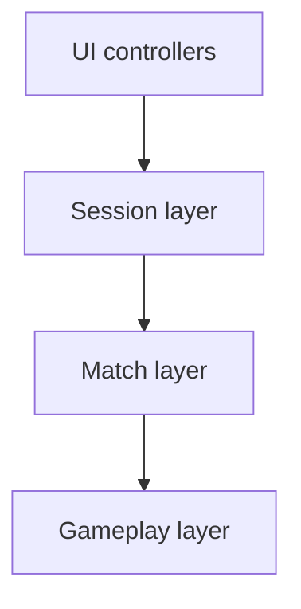

# Project architecture

## Scene flow

```
00_Boot → 00_MainMenu → 01_Lobby → 02_Game_Arena | 03_Game_Plaza | 04_Game_Ruins
```

| Scene | Responsibility |
|-------|----------------|
| `00_Boot` | Bootstrap, loads Main Menu |
| `00_MainMenu` | Profile, create/join, session browser, reconnect |
| `01_Lobby` | Player list, start match |
| `02–04_Game_*` | Gameplay maps |

## Folder layout (by responsibility)

```
Assets/_Project/
├── Docs/           Assignment, setup, testing, this file
├── Editor/         Scene generators, validation, UI bake tools
├── Prefabs/        Network prefabs + UI prefabs (when baked)
├── Scenes/         Boot, menu, lobby, maps
├── Configs/        ScriptableObject assets (match, combat, maps, modes, …)
├── Resources/
│   ├── Configs/    GameConfigs hub (Resources.Load path)
│   └── Environment/ Environment piece prefabs
└── Scripts/
    ├── Core/       Shared constants, scene indices, bridges
    ├── Session/    ConnectionManager, lobby, session data
    ├── Match/      GameManager, combat rules, votes
    ├── Players/    Registry, ownership, bot takeover
    ├── Reconnect/  ReconnectService, SessionReconnectPresenter
    ├── Networking/ NetworkAuthority, NetworkRigidbody3D, PhysicsProp
    ├── Bootstrap/  BootLoader, scene guards
    ├── Data/       ScriptableObject configs, GameConfigs hub, NetworkSpawnFactory, MatchStatsDatabase
    ├── Input/      New Input System wrappers
    ├── AI/         BotBrain
    ├── Combat/     Weapons, projectiles
    ├── Building/   Builder tool, placed blocks
    ├── Player/     Avatars, movement, look, PlayerData
    ├── Environment/ Map builders, spawn layouts
    ├── Chat/       ChatManager, messages
    └── UI/           Screen controllers; UI/Build layout helpers
```

## ScriptableObject configs

| Asset | Role |
|-------|------|
| `GameConfigs` hub | Single entry; `GameConfigs.Current` set at Boot / ConnectionManager |
| `MatchConfig` | Match/vote timers, physics-prop spawn intervals |
| `CombatConfig` | Crit chance / multiplier |
| `ReconnectConfig` | Reconnect window seconds |
| `PlayerStatsConfig` | Max health, respawn delay |
| `BotConfig` | BotBrain perception / movement |
| `DifficultyCatalog` | Damage multipliers + labels |
| `MapCatalog` + `MapDefinition` | Per-map spawn strategy (`IMapStrategy`) |
| `GameModeCatalog` + `GameModeDefinition` | Mode labels + build/combat/break flags |
| `UiThemeConfig` | UI colors (read by `UiTheme`) |
| `NetworkPrefabCatalog` | Avatar / PlayerData / projectile / prop / block (+ env) |

Spawns go through `NetworkSpawnFactory` (catalog first, scene SerializeField fallback).

## Code layers



| Layer | Types | Responsibility |
|-------|-------|----------------|
| UI | MainMenuUI, LobbyUI, ChatUI | Bind widgets, user input |
| Session | ConnectionManager, SessionReconnectPresenter | Runner, lobby, reconnect |
| Match | GameManager | Slots, timer, votes, game over |
| Gameplay | PlayerAvatar, BotBrain, PlayerWeapon | Movement, combat, AI |

## Assembly definitions

| Assembly | Contents | Fusion weave |
|----------|----------|--------------|
| `FusionMultiplayer.Runtime` | Session, Match, Players, Reconnect, Bootstrap, Data, Networking, Gameplay (Player, AI, Combat, …), Chat, Core | Yes |
| `FusionMultiplayer.UI` | UI controllers; `UI/Build/` layout rebuild tools | No |
| `FusionMultiplayer.Editor` | Generators, validators, UI bake menu | No |

## Key types

| Type | Layer | Role |
|------|-------|------|
| `ConnectionManager` | Session | NetworkRunner, partials: lobby / start / lifecycle / callbacks |
| `SessionReconnectPresenter` | Reconnect | Reconnect button visibility on main menu |
| `ReconnectService` | Reconnect | Shared-master token + avatar restore |
| `GameManager` | Match | Networked match state (partials: slots, flow, config); Shared master SA |
| `PlayerRegistry` | Players | PlayerData and avatar lookup |
| `NetworkAuthority` | Networking | Shared master checks + `GameMode.Shared` start |

## Editor vs runtime

- **Runtime:** assemblies above; menu UI talks to session via `ISessionConnection` / `ISessionBrowser`.
- **Editor:** scene/prefab generation, Validate Setup, UI bake menu.
- **Optional:** Python scene patch scripts under `Editor/` (editor-only).

## Related docs

- [ASSIGNMENT.md](ASSIGNMENT.md) — feature requirements
- [SETUP.md](SETUP.md) — Fusion import, weave, play mode
- [TESTING.md](TESTING.md) — manual test checklist
